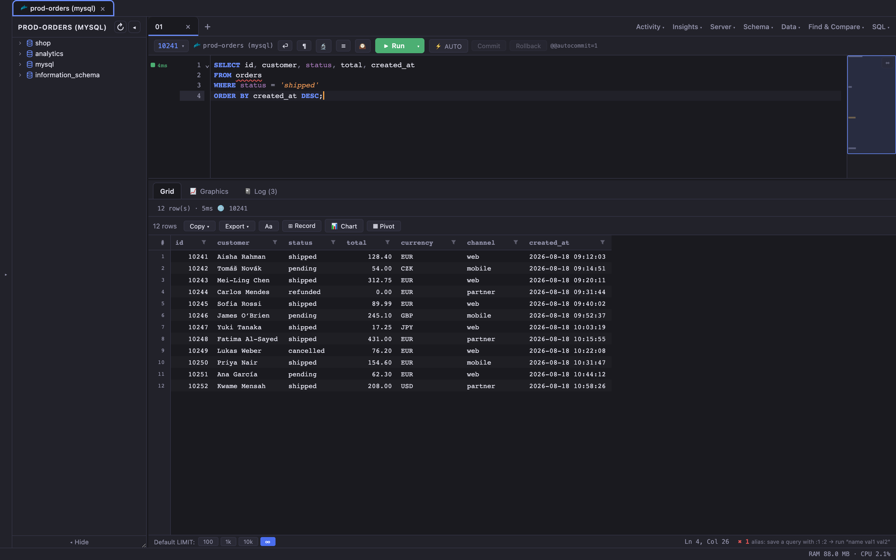

# TxUI


")


, 17.10, 18.4 (TLS) + streaming standby")


")
")


**A fast, DBA-focused desktop database GUI.** Tauri 2 + Rust + React 19. No server, no cloud — nothing leaves the machine.

## Install

**macOS · Linux** — one-liner (checksum-verified, quarantine handled):

```bash
curl -fsSL https://tuxie.eu/txui/install.sh | bash
```

**macOS — Homebrew:**

```bash
brew install --cask tuxie80/tap/txui
```

- **Windows**: NSIS setup / MSI from the [latest release](https://github.com/tuxie80/txui/releases/latest)
- **Older versions**: every release stays on the [releases page](https://github.com/tuxie80/txui/releases)
- **Self-update**: built in — status-bar chip, restart to apply
- macOS is ad-hoc signed (no $99 Apple tax): first open = right-click → Open, or `xattr -cr /Applications/TxUI.app`

**Docs**: [tuxie.eu/txui/docs](https://tuxie.eu/txui/docs/) · [older versions](https://tuxie.eu/txui/docs-archive/) · [unreleased main](https://tuxie.eu/txui/dev/)

## Engines

MySQL / MariaDB / Percona · PostgreSQL · Redis · ClickHouse · SQLite · DuckDB · MongoDB · SQL Server · Parquet files

## What you get

- **FastGrid** — one grid, virtualized both axes; 60 fps at 1M rows; copy/export in 6+ formats (incl. real .xlsx, GeoParquet)
- **Real SQL editor** — CodeMirror 6; schema-aware completion that quotes what it inserts; hover, signature help, live squiggles; formatter profiles; minimap
- **Statement-at-caret runs** — per-statement timing, run-to-cursor, drafts survive restarts, big results stream in pages
- **Geospatial, end to end** — WKB/EWKB/GeoPackage/SpatiaLite decoded client-side; map view on an offline basemap; PostGIS "View in WGS 84"; SQL Server "View as geo"; MongoDB GeoJSON, ClickHouse geo, Redis GEO — all drawable
- **DBA layer** — processlist + kill, lock chains, deadlock graphs, replication, variables/status, monitor with sparklines, 230+ curated DBA views
- **Server tuner** — per-engine rule packs (MySQL, PG, ClickHouse, Redis, SQLite, SQL Server) with health score and generated, never-executed fixes
- **Query Store (SQL Server)** — plan history, regression ranking, plan forcing; EXPLAIN visualized everywhere else, guarded EXPLAIN ANALYZE
- **Schema tooling** — ER diagrams, schema/data compare with migration scripts, documenter (Markdown/HTML + Mermaid)
- **Data in and out** — CSV import wizard (transactional, cancellable; native PG COPY; ClickHouse batches), data generator (schema kits, distributions, up to 10M rows), dump/restore wrappers
- **Fleet ops** — multi-server execution, immutable audit log, query history, saved queries
- **Safety by default** — prod tags with typed confirmations + server-side hard limits, dialect-aware write guard enforced in Rust, read-only at the driver level, SSH tunnels, optional encrypted vault
- **Extras** — Redis browser (console, key TTLs, Sentinel), ClickHouse dictionary editor, PG LISTEN/NOTIFY, Dolphie replay files, TxShell typed pipelines, pivot/charts on any result
- **Same app on all three desktops** — one behavior, native menus everywhere

## Tested versions

| Engine | Versions tested live |
| --- | --- |
| MySQL / Percona | 8.0.46, 8.4.10 (earlier: 8.0.29, 8.0.43-google, Cloud SQL 8.0) |
| MariaDB | 10.6.27, 10.11.18, 11.4.12, 11.8.8 |
| PostgreSQL | 14.23, 16.10 (md5), 17.10, 18.4 (TLS) + streaming standby |
| Redis | 8.10.0 |
| ClickHouse | 26.7.2.59, 26.8 |
| SQLite | 3.51.3 (bundled; reads any 3.x file) |
| DuckDB | bundled duckdb-rs (compiled in, pinned) |
| MongoDB | 8.0 (8.0.29 fixture) |
| SQL Server | 2022 (29 live tests) |
| Parquet | file-format level (any parquet file) |

## Why it exists

*From the author:* TxUI is something I've wanted for a long time — a go-to UI that actually fits how I work. No AI slop, no half-finished dead ends: verified, cross-referenced, tested. Built for high-privilege users — admins and DevOps who live in databases. A one-man hobby show, running on enthusiasm and no shortage of tokens. Feedback, bugs and feature requests welcome!

*The name: Tx = Tuxie (my nickname), and also (database) transaction ;-)*



## Develop

```bash
npm install                      # once
cd src-tauri && cargo tauri dev  # hot-reload dev app
```

```bash
npx tsc --noEmit -p tsconfig.app.json   # typecheck (the -p is NOT optional)
npm run lint && npm run build
npm test                                # 4,746 unit tests — needs Node ≥ 23 (type stripping)
cd src-tauri && cargo test --lib        # 866 backend unit tests
```

## Release builds

- **CI**: push a `v*.*.*` tag → macOS (universal), Linux (AppImage/deb/rpm), Windows (NSIS/MSI), drafted as a GitHub Release
- **Local**: `crossbuild/build_macos.sh` on the Mac, `build_linux.sh` on Linux, `build_windows.sh` cross-builds from either

Internal design docs are kept out of this repository by design.
