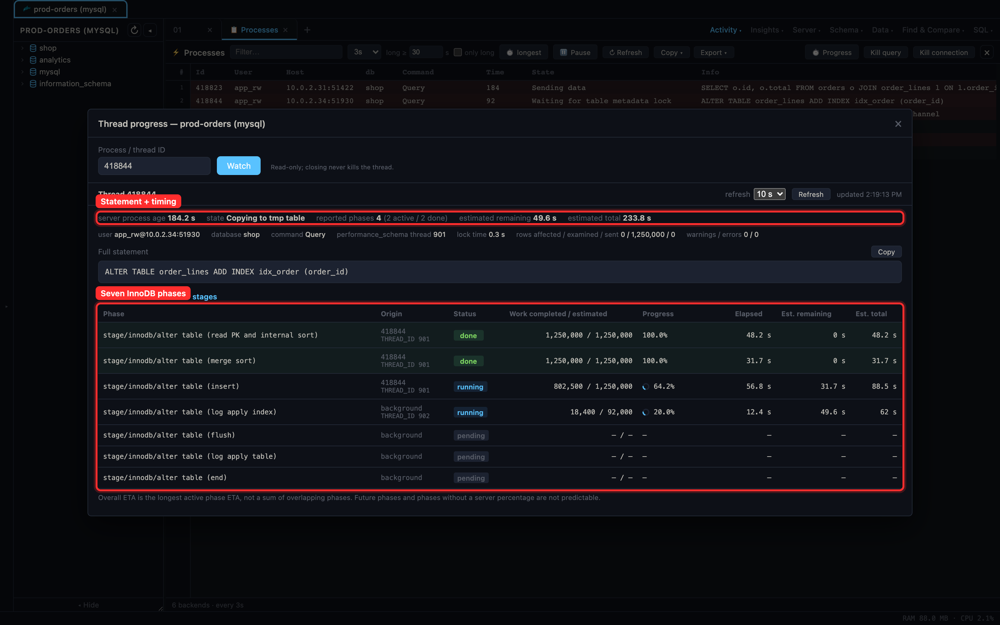

# TxUI


[![Built with Kimi](https://img.shields.io/badge/Built%20with-Kimi-1783FF?logo=)](https://www.kimi.com/)

")


, 17.10, 18.4 (TLS) + streaming standby")


")
")


**A fast, DBA-focused desktop database GUI.** Tauri 2 + Rust + React 19. No server component; database work stays local by default, and optional external integrations are explicit.

**Website: [tuxie.eu/txui](https://tuxie.eu/txui/)**



## Install

**macOS · Linux** — one-liner (checksum-verified, quarantine handled):

```bash
curl -fsSL https://tuxie.eu/txui/install.sh | bash
```

**macOS — Homebrew:**

```bash
brew install --cask tuxie80/tap/txui
```

- **Windows**: NSIS setup / MSI from the [latest release](https://github.com/tuxie80/txui/releases/latest)
- **Self-update**: built in — status-bar chip, restart to apply
- **macOS first open (important)**: the build is ad-hoc signed — no $99 Apple Developer ID — so Gatekeeper may say *"TxUI is damaged"* or *"unidentified developer"* on the first launch. **Do not move the app to Trash.** Copy it to `/Applications`, then use either fix once:
  - right-click the app → **Open** → **Open** in the dialog, or
  - run `xattr -cr /Applications/TxUI.app` in Terminal, then open TxUI normally.

  (The one-liner installer and Homebrew already strip the quarantine flag — this applies to a manual DMG download.)

## Documentation

- [User guide and complete reference](https://tuxie.eu/txui/docs/)
- [Development documentation](https://tuxie.eu/txui/dev/)

## Engines and highlights

- **MySQL / MariaDB / Percona** — full DBA tooling, process/thread progress, replication, Galera and Group Replication dashboards, maintenance, routines and playground scenarios.
- **PostgreSQL** — workload investigations correlating statement deltas, waits and incidents; graphical plans, LISTEN/NOTIFY, COPY, routines, vacuum/bloat and replication tools.
- **Redis** — standalone, Cluster and Sentinel connections; MOVED/ASK routing, cluster-wide scans, master discovery and failover rediscovery; key browser, audits and tuner.
- **ClickHouse** — HTTP SQL sessions, allowlisted session settings, `system.*` DBA views, dictionary editing, tuner and Geo types.
- **DuckDB 2.0** — local files and `:memory:`, explicit file creation, spatial support, plus authenticated **Quack remote** connections with TLS fingerprint pinning and cancellation.
- **SQL Server** — T-SQL editor and full DBA tooling, including Query Store plan history, regression ranking and plan forcing.
- **SQLite and Parquet** — full local SQL on SQLite; deep read-only Parquet file/dataset inspection, page indexes, nested data and GeoParquet.
- **MongoDB** — deliberately scoped: database/collection tree, find editor, aggregation, explain, JSON grid and GeoJSON.

## What you get

- **FastGrid** — one grid, virtualized both axes; 60 fps at 1M rows; precise selection, filtering, aggregates and charts; copy/export in 6+ formats including real `.xlsx` and GeoParquet.
- **Real SQL editor** — CodeMirror 6 with schema-aware completion, quoting, hover, signature help, live diagnostics, formatter profiles, minimap, split editing and a configurable caret.
- **Reliable statement execution** — statement-at-caret and run-to-cursor, exact per-statement wall times in results and gutter markers, timing proofs that survive unrelated edits, and drafts that survive restarts.
- **TxShell** — typed pipelines, connection fan-out, file input/output, captured-result diffs with typed keys, and bounded `$(…)` command substitution.
- **SQL Quality and plans** — static lint, type audits, schema review, graphical EXPLAIN and guarded EXPLAIN ANALYZE; **Change review** checks MySQL/MariaDB/PostgreSQL migrations for type, nullability, index/FK, cascade and lock/rebuild risks.
- **DBA layer** — processlist + kill, on-demand thread progress, lock chains, deadlock graphs, replication, variables/status, monitor with sparklines and 230+ curated DBA views.
- **Workload analysis** — PostgreSQL baseline/after investigations combine statement deltas, optional wait samples and retained incidents without an always-on collector.
- **Server tuner** — per-engine rule packs with health scores and generated, never-executed fixes.
- **Geospatial, end to end** — WKB/EWKB/GeoPackage/SpatiaLite decoding, offline and optional online maps, PostGIS transforms, SQL Server geo, MongoDB GeoJSON, ClickHouse geo, Redis GEO and GeoParquet.
- **Schema tooling** — ER diagrams, schema/data/result/script compare, reviewed migration scripts, documenter, routines, table designer and virtual foreign keys.
- **Data in and out** — CSV/spreadsheet import, native PostgreSQL COPY, a deterministic data generator with schema kits and uniqueness controls, and dump/restore wrappers.
- **Fleet operations** — multi-server execution, replica-set and fleet checks, immutable audit log, query history, saved queries and incident timelines.
- **Safety by default** — production confirmations and server-side hard limits, dialect-aware write guards in Rust, driver-level read-only enforcement, SSH tunnels and an optional encrypted Safe Vault.
- **One app on all three desktops** — native menus and the same behavior on macOS, Windows and Linux.

## Tested versions

| Engine | Versions tested live |
| --- | --- |
| MySQL / Percona | 8.0.46, 8.4.10 (earlier: 8.0.29, 8.0.43-google, Cloud SQL 8.0) |
| MariaDB | 10.6.27, 10.11.18, 11.4.12, 11.8.8 |
| PostgreSQL | 14.23, 16.10 (md5), 17.10, 18.4 (TLS) + streaming standby |
| Redis | 8.10.0; Cluster and Sentinel failover fixtures |
| ClickHouse | 26.7.2.59, 26.8 |
| SQLite | 3.51.3 (bundled; reads any 3.x file) |
| DuckDB | 2.0 through bundled duckdb-rs 1.20000.1; local and two-process Quack checks |
| MongoDB | 8.0 (8.0.29 fixture) |
| SQL Server | 2022 (29 live tests) |
| Parquet | file-format level (any Parquet file) |

## Why it exists

*From the author:* TxUI is something I've wanted for a long time — a go-to UI that actually fits how I work. Built for high-privilege users: admins and DevOps who live in databases.

**Kimi was used almost exclusively as the AI coding model throughout development. Database queries and their tuning are my own work.** Every feature is reviewed, cross-referenced and tested; AI assistance does not replace verification. It remains a one-man hobby project, running on enthusiasm and no shortage of tokens. Feedback, bugs and feature requests are welcome!

*The name: Tx = Tuxie (my nickname), and also (database) transaction ;-)*
